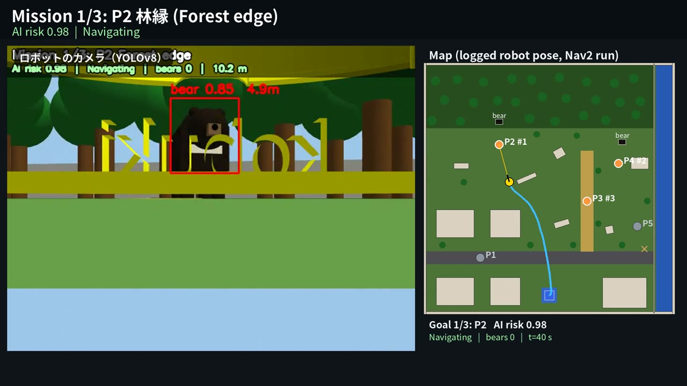
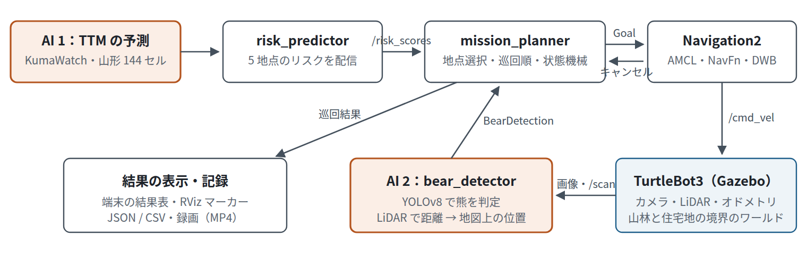
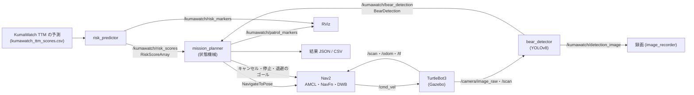
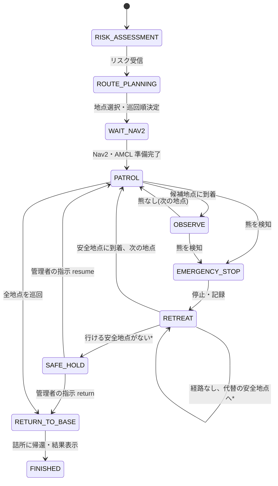
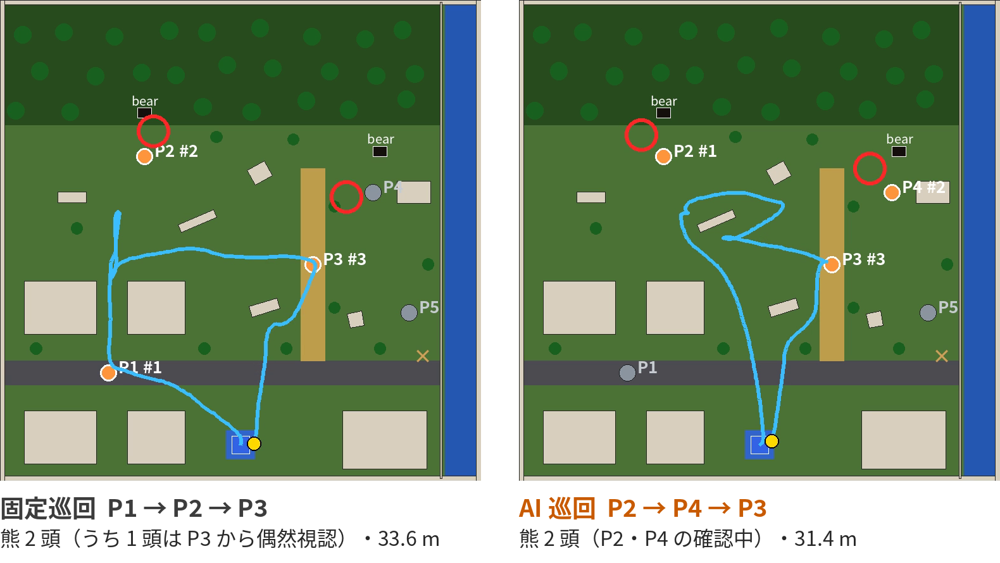
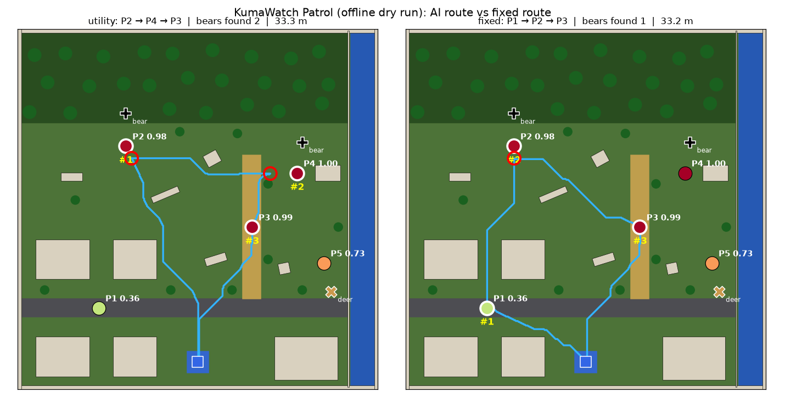

# KumaWatch Patrol

[English](README.md) | **日本語**

**KumaWatch Patrol: Risk-Aware Robotic Patrol for Bear Encounters**
（KumaWatch Patrol：AIによる熊出没リスク巡回ロボット）

研究プロジェクト KumaWatch（非公開の研究リポジトリ）の熊出没予測 AI（**TTM**）が選んだ地点を、
**ROS 2 Humble**・**Gazebo Classic 11** 上の移動ロボット（TurtleBot3 / Happy Mini）が **Navigation2** で自律巡回します。
ロボットはカメラ画像をもう一つの AI（**YOLOv8**）で判定し、熊を見つけると安全な距離で停止して記録し、
熊から離れた安全地点へ退避してから巡回を続けます。

[](https://www.youtube.com/watch?v=k5Kr4eU_tf8)

| | |
|---|---|
| 動画（2 分 42 秒） | **<https://www.youtube.com/watch?v=k5Kr4eU_tf8>**（[リポジトリ内の MP4](docs/videos/KumaWatch_Patrol_final.mp4)） |
| レポート（A4。日本語 6 ページ・英語 5 ページ） | [日本語 PDF](docs/report/KumaWatch_Patrol_final_report.pdf) / [英語 PDF](docs/report/KumaWatch_Patrol_final_report_en.pdf)（Word も同じフォルダ） |
| ソフトウェア | Ubuntu 22.04、ROS 2 Humble、Gazebo Classic 11、Navigation2、Python 3.10、Ultralytics YOLOv8（[詳細](#4-ソフトウェアとバージョン)） |
| AI | TTM（時系列予測の基盤モデル）によるリスク予測と、追加学習した YOLOv8n によるカメラ画像の熊判定 |
| データ | リスク：5 地点分の**事前計算済み** TTM スコア（山形県の公開出没データから計算。データそのものは含まない）。町・地点・熊：**架空・模擬**。学習画像：Gazebo で作った**合成画像** |
| 結果（1 回の走行） | 3 地点中 3 地点を確認、YOLOv8 で熊 2 頭を発見、P4 で退避、詰所に帰還（[結果](#7-gazebo-での実行結果と固定ルートとの比較)） |

## 目次

1. [作品の目的](#1-作品の目的)
2. [システム構成](#2-システム構成)
3. [AI を使用した部分](#3-ai-を使用した部分)
4. [ソフトウェアとバージョン](#4-ソフトウェアとバージョン)
5. [起動手順](#5-起動手順)
6. [使用したモデルとデータ（公開データか模擬データか）](#6-使用したモデルとデータ公開データか模擬データか)
7. [Gazebo での実行結果と固定ルートとの比較](#7-gazebo-での実行結果と固定ルートとの比較)
8. [既知の制約](#8-既知の制約)
9. [今後の課題](#9-今後の課題)
10. [使用した外部ソフトウェア・素材とライセンス](#10-使用した外部ソフトウェア素材とライセンス)
11. [リポジトリの構成](#11-リポジトリの構成)
12. [開発者向け](#12-開発者向け)

---

## 1. 作品の目的

熊の人里への出没が増えていますが、限られた人員で通学路・ごみ集積所・林縁などのすべてを毎日見回ることはできません。
KumaWatch は「どこに出やすいか」を予測します。本作品は、その予測をロボットの「行動」につなげます。

1. **AI（TTM）** が候補地点の熊出没リスクを予測し、
2. 巡回可能な地点数 *K*＝3 と移動距離を考えて、巡回する地点と順番を決め、
3. **Navigation2** でロボットが自律巡回し、
4. **AI（YOLOv8）** がカメラ画像から熊を見つけたら、安全な距離で停止・記録し、熊から離れた安全地点へ退避して、
5. 詰所に戻って結果を表示します（端末・RViz・JSON/CSV）。

## 2. システム構成



*橙の枠が AI を使う部分。ノード間は ROS 2 のトピック（リスク・熊検知は独自メッセージ）と Nav2 の `NavigateToPose` アクションでつながります。*



### 状態遷移（`mission_planner`）



\* `on_bear:=retreat`（既定）の場合。熊の真反対 3 m の安全地点へ Nav2 が行けないときは、向きを ±45°・±90° 変えた代替の安全地点を
順に試します（熊から離れる候補のみ）。どれにも行けなければ **`SAFE_HOLD`** に入り、その場で停止したまま `/kumawatch/operator_alert` に
通知を出し、`/kumawatch/operator_command` で管理者の指示（`resume` / `return` / `finish`）を待ちます。

```bash
ros2 topic pub --once /kumawatch/operator_command std_msgs/String "{data: resume}"
```

`on_retreat_fail:=continue` にすると、動画とレポートの走行時の動作（次の地点へ進む）に戻ります。`safe_hold_timeout` を設定すると、
その時間が過ぎたら詰所へ戻ります。`on_bear:=continue` では `EMERGENCY_STOP` から直接次の地点へ進みます。

### ノードとトピック

| ノード | 機能 | 主な入力 → 出力 |
|---|---|---|
| `risk_predictor` | 地点ごとのリスクを配信 | TTM の予測 CSV → `/kumawatch/risk_scores`, `/kumawatch/risk_markers` |
| `bear_detector` | カメラ画像を YOLOv8 で判定し、LiDAR で距離を測って地図上の位置を推定 | `/camera/image_raw`, `/camera/camera_info`, `/scan`, `/tf` → `/kumawatch/bear_detection`, `/kumawatch/detection_image` |
| `mission_planner` | 地点選択・巡回順決定・巡回・停止と退避・`SAFE_HOLD`・結果表示 | `/kumawatch/risk_scores`, `/kumawatch/bear_detection`, `/odom`, `/kumawatch/operator_command` → `navigate_to_pose`, `/cmd_vel`, `/kumawatch/patrol_markers`, `/kumawatch/patrol_summary`, `/kumawatch/mission_status`, `/kumawatch/operator_alert` |
| `bear_proximity_monitor` | 熊の既知座標との距離で検知する簡易版（動作確認用） | `/tf` → `/kumawatch/bear_detection` |
| `fake_nav2` | Gazebo・Nav2 なしで流れを確かめる簡易シミュレータ | `navigate_to_pose` サーバ, `/tf`, `/odom` |
| `image_recorder` | カメラ映像を状態表示付きで MP4 に録画、熊検知時の静止画を保存 | 画像トピック, `/kumawatch/mission_status`, `/kumawatch/bear_detection` → MP4 / JPEG |
| `chase_camera`, `mission_console` | 動画用：Gazebo でロボットを追うカメラと、短い進行ログの表示 | `/gazebo/*` サービス, `/kumawatch/mission_events` |

### パッケージ

| パッケージ | 内容 |
|---|---|
| `kumawatch_interfaces` | 独自メッセージ `RiskScore` / `RiskScoreArray` / `BearDetection` |
| `kumawatch_ai` | `risk_predictor`、`bear_detector`、学習済みの重み（`models/`）、データ（`data/`） |
| `kumawatch_mission` | 地点選択・巡回順（`route_planning.py`）、`mission_planner` などのノード、launch |
| `kumawatch_gazebo` | ワールド定義 `config/world_layout.yaml`、生成済みワールド、ワールド・地図の生成、`sim.launch.py` |
| `kumawatch_navigation` | Nav2 のパラメータ、生成済みの地図（ワールドと同じ定義から生成）、RViz の設定 |

## 3. AI を使用した部分

AI は **2 か所** で使います。その間の地点選択は、AI の予測を入力とする規則で、AI モデルではありません。

### AI 1：熊出没リスクの予測（TTM）

KumaWatch が公開している **IBM Granite TinyTimeMixer（TTM 1536-96-R2）** の予測を使います。
TTM は時系列予測の基盤モデルです。KumaWatch では、山形県の 10 km グリッド 144 セルの日別出没件数を入力に、
2025 年（学習に使っていない期間）の各日の出没をゼロショットで予測しています。

町は架空ですが、5 地点のリスクは 2025-06-07 の **実在セルの TTM 予測値** です
（リスク＝その日の県内 144 セル中の順位を百分位にした値。`scripts/import_kumawatch_ttm.py` で割り当て）。

| 地点 | 環境 | セル | TTM 順位 | リスク | 2025-06-07 の実際の出没 | Gazebo の熊 |
|---|---|---|---:|---:|---|---|
| P4 | ごみ集積所 | 5_1 | 1 / 144 | 1.000 | **あり** | あり |
| P3 | 通学路 | 4_1 | 2 / 144 | 0.993 | なし（AI の空振り） | なし |
| P2 | 林縁 | 1_10 | 4 / 144 | 0.979 | **あり** | あり |
| P5 | 河川沿い | 6_0 | 40 / 144 | 0.727 | なし | なし（シカ） |
| P1 | 住宅地 | 1_0 | 93 / 144 | 0.357 | なし | なし |

その日に実際に出没があった 2 セルを P2・P4 にし、Gazebo でもそこに熊を置きました。上位に入った空振り（P3）もあえて含めています。

### AI 2：カメラ画像からの熊判定（YOLOv8）

COCO で学習済みの YOLOv8 は、Gazebo の熊（基本図形の組み合わせ）を熊と認識できず、信号機や人に誤認しました。
そこで Gazebo で撮った 700 枚で YOLOv8n を **追加学習** しました。正解の枠は、熊の 3D 位置を画像に投影して自動で付けています。

| Precision（検証 105 枚） | Recall | mAP@0.5 | 巡回中の視点 |
|---:|---:|---:|---:|
| 0.94 | 0.99 | 0.985 | 11 / 11（シカ・木・建物を熊と誤認しない） |

`bear_detector` は LiDAR で距離を測り、3 フレーム連続で検出し、かつ 4 m 以内に近づいたときに停止を指示します。

### 巡回地点の選び方（規則。AI ではない）

$$U_i = w_i\,p_i - \lambda\,d_i$$

*p<sub>i</sub>*：AI リスク、*w<sub>i</sub>*：社会的重要度（通学路 1.2、住宅地 1.1、他 1.0）、*d<sub>i</sub>*：詰所からの距離 [m]、*λ*＝0.02。
上位 *K*＝3 地点を、総移動距離が最小になる順に回ります：**P2（林縁）→ P4（ごみ集積所）→ P3（通学路）**。

## 4. ソフトウェアとバージョン

| ソフトウェア | バージョン |
|---|---|
| OS | Ubuntu 22.04 |
| ROS 2 | **Humble** |
| シミュレータ | **Gazebo Classic 11**（`gazebo_ros_pkgs`） |
| ナビゲーション | Navigation2（Humble。AMCL・NavFn・DWB） |
| ロボットのモデル | TurtleBot3 `waffle`（既定）または `happy_mini`（講義環境） |
| Python | 3.10 |
| AI のライブラリ | Ultralytics 8.3.74（YOLOv8）、PyTorch 2.6.0、NumPy 1.26.4（2 未満が必要）、OpenCV 4.5.5 ― 講義の Docker イメージで確認 |

Python のパッケージは [requirements.txt](requirements.txt) にまとめました。講義の Docker イメージ
`airobotbook/ros2-desktop-ai-robot-book-humble` にはすべて入っています（[docs/lecture_env.md](docs/lecture_env.md)）。

## 5. 起動手順

```bash
# ROS 2 Humble のパッケージ
sudo apt install ros-humble-gazebo-ros-pkgs ros-humble-navigation2 ros-humble-nav2-bringup \
                 ros-humble-turtlebot3 ros-humble-turtlebot3-gazebo python3-colcon-common-extensions
# ワークスペース
mkdir -p ~/kumawatch_ws && cd ~/kumawatch_ws
git clone https://github.com/todalaba/KumaWatch-Patrol.git src/KumaRobot
pip3 install --user -r src/KumaRobot/requirements.txt
source /opt/ros/humble/setup.bash
colcon build --symlink-install
source install/setup.bash

# 一括起動：Gazebo + Nav2 + RViz + AI + ミッション
source /usr/share/gazebo/setup.sh
ros2 launch kumawatch_mission kumawatch_patrol.launch.py                    # AI ルート
ros2 launch kumawatch_mission kumawatch_patrol.launch.py strategy:=fixed    # 固定ルート（P1→P2→P3）
```

起動すると、AI のリスク → 巡回計画 → Nav2 で巡回 → YOLOv8 が熊を見つけたら停止 → 安全地点へ退避 → 次の地点 →
詰所に帰還 → 結果表示、の順に自動で進みます。Docker 用の設定は [`docker/`](docker/Dockerfile) にあります。

| 引数 | 既定値 | 説明 |
|---|---|---|
| `strategy` | `utility` | `utility`（U=w·p−λd）/ `topk`（リスク上位）/ `fixed`（P1→P2→P3） |
| `budget_k` | `3` | 巡回地点数 *K* |
| `risk_mode` | `ttm` | `ttm`（KumaWatch の TTM の予測）/ `simulated`（模擬データのロジスティック回帰）/ `model` |
| `detector` | `camera` | `camera`（カメラ画像の YOLOv8）/ `proximity`（既知座標との距離） |
| `on_bear` | `retreat` | 熊の検知後：`retreat`（3 m 離れた安全地点へ退避して次へ）/ `continue` / `finish`（打ち切って帰還） |
| （パラメータ）`on_retreat_fail` | `hold` | 行ける安全地点がないとき：`hold`（`SAFE_HOLD` で管理者の指示を待つ）/ `continue`（記録した走行と同じ）。`config/mission_params.yaml` で設定 |
| `robot_model` | `waffle` | `waffle` / `waffle_pi` / `happy_mini` |
| `record` | `false` | `true` でカメラ映像と検出映像を録画（[docs/recording.md](docs/recording.md)） |
| `nav2_delay` | `5.0` | Nav2 の起動を待つ秒数（重い PC では増やす） |
| `sensor_viz` | `true` | `false` で Gazebo の LiDAR の扇形とカメラの視野表示を消す（動画用） |
| `gui` / `rviz` | `true` | Gazebo の画面 / RViz を表示する |

そのほかの起動方法：

```bash
# 端末を分けて起動
ros2 launch kumawatch_gazebo sim.launch.py robot_model:=happy_mini
ros2 launch kumawatch_navigation navigation.launch.py
ros2 launch kumawatch_mission patrol_nodes.launch.py
# Gazebo なし（ノート PC・CI）：直線で動く簡易シミュレータ、熊は既知座標で判定
ros2 launch kumawatch_mission dry_run.launch.py time_scale:=8.0
```

結果は `~/kumawatch_patrol_output/<日時>_<strategy>/` に保存されます：`patrol_summary.json`、`patrol_results.csv`、
`bear_events.csv`（熊の位置・時刻・距離・信頼度）、`mission_events.csv`、`trajectory.csv`。

## 6. 使用したモデルとデータ（公開データか模擬データか）

| ファイル | 内容 | 公開データ / 模擬データ |
|---|---|---|
| `src/kumawatch_ai/data/kumawatch_ttm_scores.csv` | 5 地点の TTM の予測値（2025-06-07） | **公開データから計算**：山形県の公開野生動物出没データ（CC BY 4.0）を KumaWatch で予測 |
| `src/kumawatch_ai/data/patrol_points.yaml` | 5 つの候補地点と詰所 | **架空**の町 |
| `src/kumawatch_gazebo/config/world_layout.yaml` | ワールド（建物・木・道路・熊 2 頭・シカ 1 頭） | **模擬**（熊は実際に出没があった地点に配置） |
| `src/kumawatch_ai/data/simulated_risk_scores.csv`、`point_features.csv`、`risk_model.json` | 旧版のロジスティック回帰のリスク（`risk_mode:=simulated` / `model`） | **模擬データ** |
| `src/kumawatch_ai/models/kumawatch_bear_yolov8n.pt` | Gazebo の熊を判定するよう追加学習した YOLOv8n | **合成画像**で学習 |
| `training/` | YOLOv8 の学習画像 700 枚・ラベル・設定・結果 | **合成画像** |

**本リポジトリでは、公開用に事前計算済みのリスクスコアを使用する。実際の自治体データおよび非公開研究コードは含まない。**
予測の元になった出没データの時系列、1 年分の予測結果、TTM の推論ノートブックは、KumaWatch（非公開の研究リポジトリ）側にあります。
実物の熊の写真や個人情報は使っていません。

## 7. Gazebo での実行結果と固定ルートとの比較

**講義の演習環境での実行**（Docker、Happy Mini、GPU なし。Gazebo・Navigation2・YOLOv8 をすべて動かし、動画に収録）：
ロボットは P2 へ向かい、YOLOv8 が熊を検知しました（信頼度 0.75、4.0 m）。停止して記録し、退避を試みました。
P4 へ向かう途中で 2 頭目を検知し（0.82、3.9 m）、停止・記録のあと安全地点へ退避しました。その後 P3 を確認し（熊なし）、
詰所に帰還しました。3 地点中 3 地点を確認、熊 2 頭、31.4 m、173 秒（シミュレーション時間）でした。



| 指標（各 1 回） | 固定ルート（P1→P2→P3） | AI ルート（P2→P4→P3） |
|---|---:|---:|
| 巡回地点の AI リスク合計 | 2.33 | **2.97** |
| 確認できた地点 | 3 / 3 | 3 / 3 |
| 熊の発見数 | 2（うち 1 頭は P3 から P4 付近の熊を偶然視認） | 2（P2・P4 の確認中） |
| YOLOv8 の信頼度（検知時） | 0.73・0.86 | 0.75・0.82 |
| 安全地点への退避 | 2 回とも成功 | P4 は成功、P2 は経路がなく失敗 |
| 移動距離（実行ログ） | 33.6 m | 31.4 m |
| 所要時間（シミュレーション時間） | 166.6 s | 173.3 s |

> **この結果は、次の 3 点を踏まえて読んでください。**
> 1. **比較は各条件 1 回のシミュレーションです。** AI ルートの一般的な優位性を証明するものではなく、Physical AI の一連の動作
>    （予測 → 地点選択 → 巡回 → 検知 → 停止・退避 → 帰還）を示すデモです。熊の配置と初期条件を変えた複数回の評価は今後の課題です。
>    （KumaWatch の 1 年を通した評価では、山形県で TTM は単純な静的予測に有意に劣っています。）
> 2. **固定ルートの 2 頭目は、P3 から P4 付近の熊を偶然検知したものです。** 固定ルートは P4 を巡回対象にしていません。
>    AI ルートは P4 を明示的な巡回対象として確認しました。
> 3. **P2 では、安全地点への経路生成に失敗しました**（退避先が建物のそば）。本試作は巡回を続けましたが、
>    **実運用では安全停止と管理者への通知を優先する必要があります。** この走行のあと、代替の安全地点の再探索と `SAFE_HOLD`
>    （安全停止・通知・指示待ち）を実装しました（[2 章](#2-システム構成)の状態遷移）。簡易シミュレータでの CI では確認済みですが、
>    Gazebo での再走行はまだです。

固定ルートは 2 回走らせ、1 回目は P2 で退避したあと経路計画が行き詰まり、帰還できませんでした（熊 1 頭）。表は 2 回目の値です。
距離は `mission_planner` が記録した値です。

<details>
<summary>以前の確認（Gazebo なし。本物の Nav2 を簡易シミュレータで動かしたもの）</summary>

`on_bear:=continue`（退避なし）で、熊は既知座標で判定し、本物の Nav2 を `scripts/nav2_kinematic_sim.py`（差動二輪 + レイキャスト LiDAR）
で動かした結果：固定ルートは熊 1 頭・28.8 m・152.6 s、AI ルートは熊 2 頭・32.5 m・153.8 s。
下の俯瞰図は `scripts/offline_dry_run.py` で描いたものです（赤丸が熊の発見位置）。


</details>

## 8. 既知の制約

- **退避できない場合の安全制御。** 記録した走行では、P2 で熊の近くのまま通常の巡回に戻りました（安全設計として弱い）。
  その後、代替の安全地点の再探索と `SAFE_HOLD` に置き換えましたが、確認は簡易シミュレータでのみです。
  安全地点は Nav2 に 1 つずつ送って試しており（事前の経路確認はしていない）、管理者への通知も ROS のトピックで、実際の連絡手段ではありません。
- **評価の回数。** 各条件 1 回の走行で、統計的な比較はしていません。
- **シミュレーションのみ。** 実環境での自己位置推定・通信・天候の影響は検証していません。
- **熊判定** は基本図形の Gazebo の熊でのみ学習・評価しました。実物の画像での精度は不明です。
  Happy Mini のカメラには車体の一部（黄色い帯とロゴの裏側）が映り込んでいます。熊は検知できましたが、カメラ位置の修正が必要です。
- **予測と地点の対応。** TTM の予測は 10 km 四方のセル単位で、町の中の 1 地点と同じ意味ではありません。日付もシナリオのために選んだ 1 日です。

## 9. 今後の課題

- `SAFE_HOLD` を入れた状態での Gazebo の再走行、移動前の Nav2 による経路確認、通知を実際の連絡手段につなぐこと
- Happy Mini のカメラへの車体の映り込みの修正
- TTM・GLM-Logit・静的予測の巡回結果の比較（KumaWatch の他モデルの予測も同じ CSV 形式で取り込める）
- 熊の配置と初期条件を変えた複数回の評価、複数回試行での発見率の比較

## 10. 使用した外部ソフトウェア・素材とライセンス

| 項目 | 用途 | ライセンス |
|---|---|---|
| [ROS 2 Humble](https://docs.ros.org/en/humble/)、[Navigation2](https://navigation.ros.org/)、[Gazebo Classic](https://classic.gazebosim.org/) | ミドルウェア・ナビゲーション・シミュレータ | Apache-2.0 |
| [TurtleBot3 シミュレーション](https://github.com/ROBOTIS-GIT/turtlebot3_simulations)（ROBOTIS） | ロボットのモデル | Apache-2.0 |
| Happy Mini（講義環境、『AI ロボット入門』） | ロボットのモデル | 講義資料の条件に従う |
| KumaWatch（非公開の研究リポジトリ） | 5 地点分の事前計算済み TTM スコア | 元データ CC BY 4.0（山形県の公開野生動物出没データ） |
| [IBM Granite TinyTimeMixer](https://huggingface.co/ibm-granite/granite-timeseries-ttm-r2) | 時系列予測モデル | Apache-2.0 |
| [Ultralytics YOLOv8](https://github.com/ultralytics/ultralytics) | 熊判定。`kumawatch_bear_yolov8n.pt` は YOLOv8n を追加学習したもの | AGPL-3.0（重みも同ライセンス） |
| 熊・シカ・建物・樹木のモデル | このリポジトリで基本図形から自作 | 外部の 3D モデルは不使用 |
| [matsuolab/physicalai_pubsub](https://github.com/matsuolab/physicalai_pubsub) | ROS 2 パッケージ構成の参考 | ― |

参考文献：Ekambaram et al., *Tiny Time Mixers (TTMs)*, NeurIPS 2024 / Jocher et al., *Ultralytics YOLOv8*, 2023 / Lin et al., *Microsoft COCO*, ECCV 2014 /
Macenski et al., *Robot Operating System 2*, Science Robotics 2022 / Macenski et al., *The Marathon 2: A Navigation System*, IROS 2020 /
Koenig and Howard, *Design and use paradigms for Gazebo*, IROS 2004。

## 11. リポジトリの構成

ROS 2 のパッケージは、それぞれの中に `launch/`・`config/`・`models/`・`data/` を持ちます（`colcon` がこの形でインストールするため）。
そのため、これらのフォルダはトップではなく各パッケージの中にあります。

```
KumaRobot/
├── README.md, README.ja.md
├── LICENSE                      # Apache-2.0（YOLOv8 の重みは AGPL-3.0。10 章）
├── requirements.txt             # Python のパッケージ
├── src/
│   ├── kumawatch_ai/            # risk_predictor, bear_detector
│   │   ├── models/              #   kumawatch_bear_yolov8n.pt
│   │   └── data/                #   kumawatch_ttm_scores.csv, simulated_risk_scores.csv, patrol_points.yaml
│   ├── kumawatch_gazebo/        # config/world_layout.yaml, worlds/, launch/sim.launch.py
│   ├── kumawatch_interfaces/    # msg/
│   ├── kumawatch_mission/       # mission_planner などのノード, launch/（kumawatch_patrol, patrol_nodes, dry_run）, config/
│   └── kumawatch_navigation/    # config/nav2_params.yaml, maps/, rviz/, launch/navigation.launch.py
├── media/                       # system_overview.png, route_comparison.png, demo.jpg
├── docs/                        # report/（PDF・Word）, videos/, lecture_env.md, recording.md, video_plan.md
├── training/                    # TTM の入力とノートブック、YOLOv8 の学習データと結果
├── scripts/                     # 学習・生成・机上シミュレーション・動画の編集（scripts/video/）
└── docker/
```

| 推奨のフォルダ | このリポジトリでの場所 |
|---|---|
| `launch/` | `src/*/launch/`（入口は `src/kumawatch_mission/launch/kumawatch_patrol.launch.py`） |
| `config/` | `src/kumawatch_gazebo/config/`、`src/kumawatch_navigation/config/`、`src/kumawatch_mission/config/` |
| `models/` | `src/kumawatch_ai/models/` |
| `data/` | `src/kumawatch_ai/data/`（`simulated_risk_scores.csv` もここ） |
| `media/` | `media/` |

## 12. 開発者向け

```bash
python3 -m pytest src                     # ROS 不要の単体テスト（リスク・熊の位置推定・地点選択・ワールド/地図・動画の補助）
python3 scripts/import_kumawatch_ttm.py --kumawatch-dir ../KumaWatch --date 2025-06-07   # TTM スコアの取り込み直し（非公開の KumaWatch が必要）
python3 scripts/generate_bear_dataset.py --out datasets/kuma_bear --n 700      # YOLO の学習画像とラベル（gzserver 起動中）
python3 scripts/train_bear_detector.py --data datasets/kuma_bear/data.yaml     # YOLOv8n の追加学習
python3 scripts/generate_world.py         # world_layout.yaml → Gazebo のワールド + Nav2 の地図
python3 scripts/offline_dry_run.py --plot docs/overview.png   # ROS なしの比較
```

- ワールドと地図は同じ `world_layout.yaml` から生成するので、SLAM なしで座標が一致します。
  熊とシカは地図に載せず、ロボットが LiDAR とカメラで見つけます。
- GitHub Actions（`.github/workflows/ci.yml`）が ROS 2 Humble 上でビルド・テスト・`dry_run`（退避と、安全地点に行けない場合の `SAFE_HOLD` を含む）を確認します。
- 動画の撮影と編集：[docs/recording.md](docs/recording.md)、[docs/video_plan.md](docs/video_plan.md)。
  以前の画面全体の録画は <https://www.youtube.com/watch?v=n9ImQzJf8u0>。

## 生成 AI の利用

このリポジトリのコード・文書・レポート・動画用ツールの作成には、生成 AI（Anthropic の Claude）の支援を受けました。
課題の設計、講義の環境での走行、結果の確認は提出者が行いました。

## License

Apache License 2.0（[LICENSE](LICENSE)）。追加学習した YOLOv8 の重み（`src/kumawatch_ai/models/kumawatch_bear_yolov8n.pt`）は
Ultralytics YOLOv8 の派生物であり、AGPL-3.0 で配布します。
