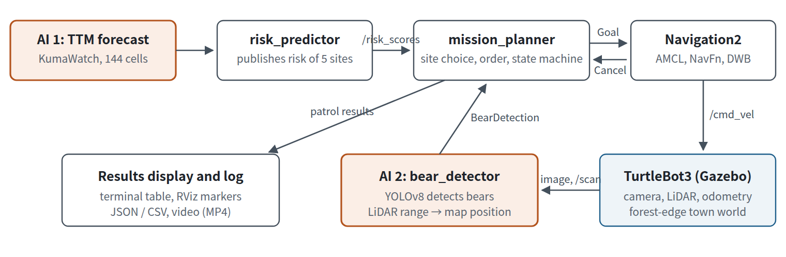
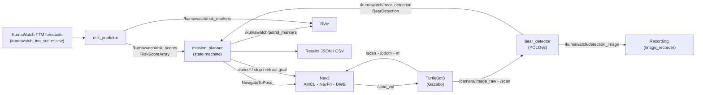
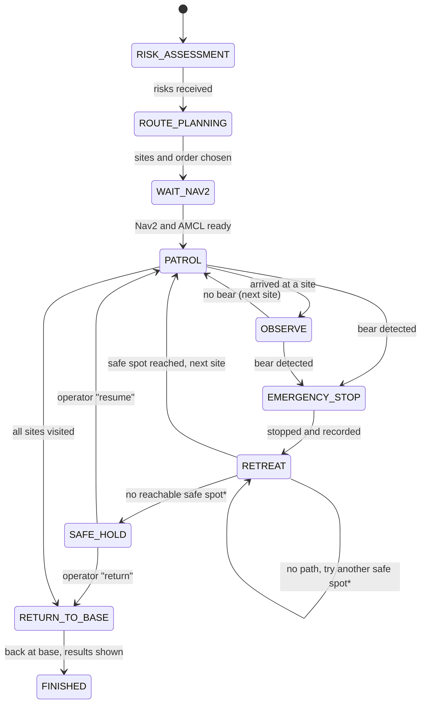
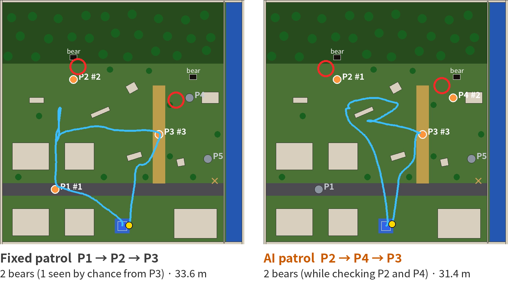

# KumaWatch Patrol

**English** | [日本語](README.ja.md)

**KumaWatch Patrol: Risk-Aware Robotic Patrol for Bear Encounters**

A mobile robot (TurtleBot3 / Happy Mini) on **ROS 2 Humble** and **Gazebo Classic 11** patrols, with **Navigation2**, the sites chosen
from the bear-sighting forecast AI (**TTM**) of the research project KumaWatch (a private research repository).
It checks its camera images with a second AI (**YOLOv8**); when it finds a bear it stops at a safe distance, records the encounter,
retreats to a safe spot away from the bear, and then continues the patrol.

[](https://www.youtube.com/watch?v=k5Kr4eU_tf8)

| | |
|---|---|
| Video (2 min 37 s) | **<https://www.youtube.com/watch?v=k5Kr4eU_tf8>** ([MP4 in this repository](docs/videos/KumaWatch_Patrol_final.mp4)) |
| Report (A4; Japanese 6 pages, English 5 pages) | [English PDF](docs/report/KumaWatch_Patrol_final_report_en.pdf) / [Japanese PDF](docs/report/KumaWatch_Patrol_final_report.pdf) (Word files in the same folder) |
| Software | Ubuntu 22.04, ROS 2 Humble, Gazebo Classic 11, Navigation2, Python 3.10, Ultralytics YOLOv8 ([details](#4-software-and-versions)) |
| AI | TTM (time-series foundation model) for risk forecasting; YOLOv8n fine-tuned for bear detection in camera images |
| Data | Risk: **precomputed** TTM scores for 5 sites (made from Yamagata Prefecture's public sighting data; the data itself is not included). Town, sites and bears: **fictional / simulated**. Training images: **synthetic** (Gazebo) |
| Result (one run) | 3 of 3 sites checked, 2 bears found by YOLOv8, retreat at P4, return to base ([results](#7-results-in-gazebo-and-comparison-with-a-fixed-route)) |

> The program's terminal output and some detailed guides under `docs/` (lecture environment, recording) are in Japanese.

## Contents

1. [Purpose](#1-purpose)
2. [System architecture](#2-system-architecture)
3. [Where AI is used](#3-where-ai-is-used)
4. [Software and versions](#4-software-and-versions)
5. [Quick start](#5-quick-start)
6. [Models and data (public or simulated)](#6-models-and-data-public-or-simulated)
7. [Results in Gazebo and comparison with a fixed route](#7-results-in-gazebo-and-comparison-with-a-fixed-route)
8. [Known limitations](#8-known-limitations)
9. [Future work](#9-future-work)
10. [External software, assets and licences](#10-external-software-assets-and-licences)
11. [Repository layout](#11-repository-layout)
12. [For developers](#12-for-developers)

---

## 1. Purpose

Bears are appearing in towns more and more often, and a limited staff cannot check every school route, garbage point and forest edge every day.
KumaWatch forecasts *where* sightings are likely; this work turns that forecast into *action* by a robot:

1. **AI (TTM)** forecasts the bear-sighting risk of each candidate site;
2. the sites to patrol and their order are chosen under a patrol budget *K* = 3 and travel distance;
3. the robot patrols them autonomously with **Navigation2**;
4. when **AI (YOLOv8)** finds a bear in the camera image, the robot stops at a safe distance, records it, and retreats to a safe spot away from the bear;
5. it returns to the base and shows the results (terminal, RViz, JSON/CSV).

## 2. System architecture



*Orange boxes are the parts that use AI. Nodes are connected by ROS 2 topics (custom messages for risk and bear detection) and the Nav2 `NavigateToPose` action.*



### State machine (`mission_planner`)



\* With `on_bear:=retreat` (the default). If Nav2 cannot reach the safe spot (3 m straight away from the bear), the robot tries alternative
safe spots turned by ±45° and ±90° (only those that take it farther from the bear). If none can be reached, it enters **`SAFE_HOLD`**: it stays
stopped, publishes an alert on `/kumawatch/operator_alert` and waits for an operator command on `/kumawatch/operator_command`
(`resume` / `return` / `finish`):

```bash
ros2 topic pub --once /kumawatch/operator_command std_msgs/String "{data: resume}"
```

`on_retreat_fail:=continue` restores the behaviour of the run shown in the video and report (go on to the next site), and `safe_hold_timeout`
returns to the base after a set time. With `on_bear:=continue` the robot goes from `EMERGENCY_STOP` straight to the next site.

### Nodes and topics

| Node | Function | Main inputs → outputs |
|---|---|---|
| `risk_predictor` | Publishes per-site risk | TTM forecast CSV → `/kumawatch/risk_scores`, `/kumawatch/risk_markers` |
| `bear_detector` | Detects bears in camera images (YOLOv8), measures distance with LiDAR, estimates map position | `/camera/image_raw`, `/camera/camera_info`, `/scan`, `/tf` → `/kumawatch/bear_detection`, `/kumawatch/detection_image` |
| `mission_planner` | Site selection, ordering, patrol, stopping and retreat, `SAFE_HOLD`, results | `/kumawatch/risk_scores`, `/kumawatch/bear_detection`, `/odom`, `/kumawatch/operator_command` → `navigate_to_pose`, `/cmd_vel`, `/kumawatch/patrol_markers`, `/kumawatch/patrol_summary`, `/kumawatch/mission_status`, `/kumawatch/operator_alert` |
| `bear_proximity_monitor` | Detects bears by distance to known coordinates (simple method for testing) | `/tf` → `/kumawatch/bear_detection` |
| `fake_nav2` | Minimal simulator for checking the flow without Gazebo/Nav2 | `navigate_to_pose` server, `/tf`, `/odom` |
| `image_recorder` | Records the camera to MP4 with a status overlay; saves a still when a bear is detected | image topic, `/kumawatch/mission_status`, `/kumawatch/bear_detection` → MP4 / JPEG |
| `chase_camera`, `mission_console` | Video aids: a camera that follows the robot in Gazebo, and a short mission log | `/gazebo/*` services, `/kumawatch/mission_events` |

### Packages

| Package | Contents |
|---|---|
| `kumawatch_interfaces` | Custom messages `RiskScore` / `RiskScoreArray` / `BearDetection` |
| `kumawatch_ai` | `risk_predictor`, `bear_detector`, trained weights (`models/`), data (`data/`) |
| `kumawatch_mission` | Site selection and ordering (`route_planning.py`), `mission_planner` and the other nodes, launch files |
| `kumawatch_gazebo` | World definition `config/world_layout.yaml`, generated world, world/map generator, `sim.launch.py` |
| `kumawatch_navigation` | Nav2 parameters, prebuilt map (generated from the same definition as the world), RViz config |

## 3. Where AI is used

AI is used in **two** places. The choice of sites in between is a rule that takes the AI forecast as input, not an AI model.

### AI 1: Forecasting bear-sighting risk (TTM)

Risk comes from the forecasts of **IBM Granite TinyTimeMixer (TTM 1536-96-R2)** published by KumaWatch.
TTM is a foundation model for time-series forecasting. KumaWatch feeds it the daily sighting counts of 144 cells of a 10 km grid over
Yamagata Prefecture and forecasts, zero-shot, every day of 2025 (a period not used for training).

The town is fictional, but the risks of the 5 sites are **TTM forecasts for real cells** on 2025-06-07
(risk = the cell's rank among the prefecture's 144 cells that day, as a percentile; assigned by `scripts/import_kumawatch_ttm.py`).

| Site | Setting | Cell | TTM rank | Risk | Actual sighting on 2025-06-07 | Bear in Gazebo |
|---|---|---|---:|---:|---|---|
| P4 | Garbage collection point | 5_1 | 1 / 144 | 1.000 | **Yes** | Yes |
| P3 | School route | 4_1 | 2 / 144 | 0.993 | No (AI false alarm) | No |
| P2 | Forest edge | 1_10 | 4 / 144 | 0.979 | **Yes** | Yes |
| P5 | Riverside | 6_0 | 40 / 144 | 0.727 | No | No (deer) |
| P1 | Residential area | 1_0 | 93 / 144 | 0.357 | No | No |

The 2 cells with an actual sighting that day became P2 and P4, and bears are placed there in Gazebo. The high-ranked false alarm (P3) is included on purpose.

### AI 2: Detecting bears in camera images (YOLOv8)

COCO-pretrained YOLOv8 did not recognise the Gazebo bears (made of primitive shapes) and mistook them for traffic lights or people,
so YOLOv8n was **fine-tuned** on 700 images taken in Gazebo. The boxes are labelled automatically by projecting each bear's 3D position into the image.

| Precision (105 val. images) | Recall | mAP@0.5 | Patrol viewpoints |
|---:|---:|---:|---:|
| 0.94 | 0.99 | 0.985 | 11 / 11 (no deer, tree or building mistaken for a bear) |

`bear_detector` measures the distance with the LiDAR and asks the robot to stop after 3 consecutive detections within 4 m.

### Choosing the patrol sites (rule, not AI)

$$U_i = w_i\,p_i - \lambda\,d_i$$

*p<sub>i</sub>*: AI risk, *w<sub>i</sub>*: social importance (school route 1.2, residential 1.1, others 1.0), *d<sub>i</sub>*: distance from the base [m], *λ* = 0.02.
The top *K* = 3 sites are visited in the order with the shortest total round trip: **P2 (forest edge) → P4 (garbage point) → P3 (school route)**.

## 4. Software and versions

| Software | Version |
|---|---|
| OS | Ubuntu 22.04 |
| ROS 2 | **Humble** |
| Simulator | **Gazebo Classic 11** (`gazebo_ros_pkgs`) |
| Navigation | Navigation2 (Humble; AMCL, NavFn, DWB) |
| Robot model | TurtleBot3 `waffle` (default) or `happy_mini` (lecture environment) |
| Python | 3.10 |
| AI libraries | Ultralytics 8.3.74 (YOLOv8), PyTorch 2.6.0, NumPy 1.26.4 (must be < 2), OpenCV 4.5.5 — verified in the lecture Docker image |

Python packages are listed in [requirements.txt](requirements.txt). The lecture Docker image
`airobotbook/ros2-desktop-ai-robot-book-humble` already has everything; see [docs/lecture_env.md](docs/lecture_env.md) (Japanese).

## 5. Quick start

```bash
# ROS 2 Humble packages
sudo apt install ros-humble-gazebo-ros-pkgs ros-humble-navigation2 ros-humble-nav2-bringup \
                 ros-humble-turtlebot3 ros-humble-turtlebot3-gazebo python3-colcon-common-extensions
# workspace
mkdir -p ~/kumawatch_ws && cd ~/kumawatch_ws
git clone https://github.com/todalaba/KumaWatch-Patrol.git src/KumaRobot
pip3 install --user -r src/KumaRobot/requirements.txt
source /opt/ros/humble/setup.bash
colcon build --symlink-install
source install/setup.bash

# all in one: Gazebo + Nav2 + RViz + AI + mission
source /usr/share/gazebo/setup.sh
ros2 launch kumawatch_mission kumawatch_patrol.launch.py                    # AI route
ros2 launch kumawatch_mission kumawatch_patrol.launch.py strategy:=fixed    # fixed route (P1→P2→P3)
```

It proceeds automatically: AI risks → patrol plan → patrol with Nav2 → stop when YOLOv8 finds a bear → retreat to a safe spot →
next site → return to base → results. A Docker setup is in [`docker/`](docker/Dockerfile).

| Argument | Default | Description |
|---|---|---|
| `strategy` | `utility` | `utility` (U=w·p−λd) / `topk` (highest risk) / `fixed` (P1→P2→P3) |
| `budget_k` | `3` | Number of sites to patrol *K* |
| `risk_mode` | `ttm` | `ttm` (KumaWatch TTM forecasts) / `simulated` (logistic regression on simulated data) / `model` |
| `detector` | `camera` | `camera` (YOLOv8 on camera images) / `proximity` (distance to known coordinates) |
| `on_bear` | `retreat` | After a bear: `retreat` (safe spot 3 m away, then continue) / `continue` / `finish` (end and return) |
| (param) `on_retreat_fail` | `hold` | When no safe spot can be reached: `hold` (`SAFE_HOLD`, wait for the operator) / `continue` (as in the recorded run). Set in `config/mission_params.yaml` |
| `robot_model` | `waffle` | `waffle` / `waffle_pi` / `happy_mini` |
| `record` | `false` | `true` records the camera and detection video ([docs/recording.md](docs/recording.md)) |
| `nav2_delay` | `5.0` | Wait before starting Nav2 [s] (increase on slow PCs) |
| `sensor_viz` | `true` | `false` hides the LiDAR fan and camera frustum in Gazebo (for videos) |
| `gui` / `rviz` | `true` | Show the Gazebo GUI / RViz |

Other ways to run:

```bash
# the parts in separate terminals
ros2 launch kumawatch_gazebo sim.launch.py robot_model:=happy_mini
ros2 launch kumawatch_navigation navigation.launch.py
ros2 launch kumawatch_mission patrol_nodes.launch.py
# without Gazebo (laptops, CI): straight-line simulator, bears from known coordinates
ros2 launch kumawatch_mission dry_run.launch.py time_scale:=8.0
```

Results are saved in `~/kumawatch_patrol_output/<datetime>_<strategy>/`: `patrol_summary.json`, `patrol_results.csv`,
`bear_events.csv` (position, time, distance and confidence of each sighting), `mission_events.csv` and `trajectory.csv`.

## 6. Models and data (public or simulated)

| File | Content | Public or simulated |
|---|---|---|
| `src/kumawatch_ai/data/kumawatch_ttm_scores.csv` | TTM forecasts for the 5 sites (2025-06-07) | **Computed from public data**: Yamagata Prefecture's open wildlife sighting data (CC BY 4.0), via KumaWatch |
| `src/kumawatch_ai/data/patrol_points.yaml` | 5 candidate sites and the base | **Fictional** town |
| `src/kumawatch_gazebo/config/world_layout.yaml` | World: buildings, trees, roads, 2 bears, 1 deer | **Simulated** (bears placed at the sites with actual sightings) |
| `src/kumawatch_ai/data/simulated_risk_scores.csv`, `point_features.csv`, `risk_model.json` | Older logistic-regression risk model (`risk_mode:=simulated` / `model`) | **Simulated** data |
| `src/kumawatch_ai/models/kumawatch_bear_yolov8n.pt` | YOLOv8n fine-tuned to detect the Gazebo bears | Trained on **synthetic** images |
| `training/` | 700 YOLOv8 training images, labels, settings and results | **Synthetic** images |

**This repository uses risk scores precomputed for public release. It does not contain the municipal sighting data itself or the
non-public research code.** The time series the forecasts were made from, the full-year forecasts and the TTM inference notebook stay in
KumaWatch (a private research repository). No photographs of real bears and no personal data are used.

## 7. Results in Gazebo and comparison with a fixed route

**Run in the lecture environment** (Docker, Happy Mini, no GPU; Gazebo + Navigation2 + YOLOv8 all running; shown in the video):
the robot went to P2 and YOLOv8 detected a bear (confidence 0.75, 4.0 m); it stopped, recorded it and tried to retreat.
On the way to P4 it detected the second bear (0.82, 3.9 m), stopped, recorded it and retreated to a safe spot. It then checked P3
(no bear) and returned to the base: 3 of 3 sites checked, 2 bears, 31.4 m, 173 s (simulation time).



| Metric (one run each) | Fixed route (P1→P2→P3) | AI route (P2→P4→P3) |
|---|---:|---:|
| Summed AI risk of the patrolled sites | 2.33 | **2.97** |
| Sites checked | 3 / 3 | 3 / 3 |
| Bears found | 2 (1 near P4, seen by chance from P3) | 2 (while checking P2 and P4) |
| YOLOv8 confidence at detection | 0.73, 0.86 | 0.75, 0.82 |
| Retreat to a safe spot | succeeded both times | P4 succeeded; P2 failed (no path) |
| Distance travelled (log) | 33.6 m | 31.4 m |
| Time taken (simulation time) | 166.6 s | 173.3 s |

> **Please read these results with three caveats.**
> 1. **The comparison is one simulation run per condition.** It does not prove a general advantage of the AI route; it demonstrates the whole
>    Physical AI pipeline (forecast → site selection → patrol → detection → stop and retreat → return). Multiple runs with different bear
>    placements and initial conditions are future work. (In KumaWatch's year-long evaluation, TTM is significantly worse in Yamagata than a simple static forecast.)
> 2. **The fixed route's second bear was the bear near P4, detected by chance from P3.** The fixed route does not include P4;
>    the AI route checked P4 as an explicit patrol target.
> 3. **At P2, path planning to the safe spot failed** (the spot was next to a building) and this prototype continued the patrol.
>    **In real operation a safe stop and a notification to the operator must take priority.** After this run, alternative safe spots and
>    `SAFE_HOLD` were implemented (see the state machine in [§2](#2-system-architecture)); they are tested in CI with the minimal simulator
>    but have not yet been re-run in Gazebo.

The fixed route was run twice; in the first run path planning got stuck after the retreat at P2 and the robot could not return (1 bear).
The table shows the second run. Distances are the values logged by `mission_planner`.

<details>
<summary>Earlier check without Gazebo (real Nav2 on a minimal simulator)</summary>

With `on_bear:=continue` and bears detected from known coordinates, the real Nav2 stack on `scripts/nav2_kinematic_sim.py`
(differential drive + ray-cast LiDAR) gave: fixed route 1 bear, 28.8 m, 152.6 s; AI route 2 bears, 32.5 m, 153.8 s.
`scripts/offline_dry_run.py` draws the bird's-eye view below (red dots: where bears were found).


</details>

## 8. Known limitations

- **Safety control when the retreat is impossible.** In the recorded run the robot returned to normal patrol near a bear (P2), a weak safety design.
  This has since been replaced by alternative safe spots and `SAFE_HOLD`, which are verified only with the minimal simulator so far.
  The safe spots are tried one by one through Nav2 (no path check in advance), and the operator interface is a ROS topic, not a real notification channel.
- **Evaluation.** One run per condition; no statistical comparison.
- **Simulation only.** Localisation, communication and weather in real environments have not been tested.
- **Bear detection** was trained and evaluated only on Gazebo bears made of primitive shapes; accuracy on real images is unknown.
  In Happy Mini's camera, part of the robot body (a yellow band and the back of a logo) is visible; detection still worked, but the camera position should be fixed.
- **Forecasts and sites.** A TTM forecast is for a 10 km cell, not a single spot in a town; the date is a single day chosen for the scenario.

## 9. Future work

- Re-run in Gazebo with `SAFE_HOLD`; check safe spots with Nav2's path planner before moving; connect the alert to a real notification channel
- Fix the robot body appearing in Happy Mini's camera
- Compare patrol results of TTM, GLM-Logit and the static prior (KumaWatch's other forecasts can be imported in the same CSV format)
- Multiple runs with different bear placements and initial conditions; detection rates over repeated trials

## 10. External software, assets and licences

| Item | Use | Licence |
|---|---|---|
| [ROS 2 Humble](https://docs.ros.org/en/humble/), [Navigation2](https://navigation.ros.org/), [Gazebo Classic](https://classic.gazebosim.org/) | Middleware, navigation, simulator | Apache-2.0 |
| [TurtleBot3 simulations](https://github.com/ROBOTIS-GIT/turtlebot3_simulations) (ROBOTIS) | Robot model | Apache-2.0 |
| Happy Mini (lecture environment, *Introduction to AI Robots*) | Robot model | per the lecture materials |
| KumaWatch (private research repository) | Precomputed TTM scores for 5 sites | source data CC BY 4.0 (Yamagata Prefecture's open wildlife sighting data) |
| [IBM Granite TinyTimeMixer](https://huggingface.co/ibm-granite/granite-timeseries-ttm-r2) | Time-series forecasting model | Apache-2.0 |
| [Ultralytics YOLOv8](https://github.com/ultralytics/ultralytics) | Bear detection; `kumawatch_bear_yolov8n.pt` is fine-tuned from YOLOv8n | AGPL-3.0 (the weights are under the same licence) |
| Bear, deer, building and tree models | Built from primitive shapes in this repository | no external 3D models |
| [matsuolab/physicalai_pubsub](https://github.com/matsuolab/physicalai_pubsub) | Reference for the ROS 2 package layout | — |

References: Ekambaram et al., *Tiny Time Mixers (TTMs)*, NeurIPS 2024; Jocher et al., *Ultralytics YOLOv8*, 2023; Lin et al., *Microsoft COCO*, ECCV 2014;
Macenski et al., *Robot Operating System 2*, Science Robotics 2022; Macenski et al., *The Marathon 2: A Navigation System*, IROS 2020;
Koenig and Howard, *Design and use paradigms for Gazebo*, IROS 2004.

## 11. Repository layout

ROS 2 packages keep their own `launch/`, `config/`, `models/` and `data/` folders (this is what `colcon` installs),
so those folders live inside each package rather than at the top level.

```
KumaRobot/
├── README.md, README.ja.md
├── LICENSE                      # Apache-2.0 (the YOLOv8 weights are AGPL-3.0, see §10)
├── requirements.txt             # Python packages
├── src/
│   ├── kumawatch_ai/            # risk_predictor, bear_detector
│   │   ├── models/              #   kumawatch_bear_yolov8n.pt
│   │   └── data/                #   kumawatch_ttm_scores.csv, simulated_risk_scores.csv, patrol_points.yaml
│   ├── kumawatch_gazebo/        # config/world_layout.yaml, worlds/, launch/sim.launch.py
│   ├── kumawatch_interfaces/    # msg/
│   ├── kumawatch_mission/       # mission_planner and other nodes, launch/ (kumawatch_patrol, patrol_nodes, dry_run), config/
│   └── kumawatch_navigation/    # config/nav2_params.yaml, maps/, rviz/, launch/navigation.launch.py
├── media/                       # system_overview.png, route_comparison.png, demo.jpg
├── docs/                        # report/ (PDF, Word), videos/, lecture_env.md, recording.md, video_plan.md
├── training/                    # TTM inputs and notebook, YOLOv8 dataset and training results
├── scripts/                     # training, generation, offline simulation, video tools (scripts/video/)
└── docker/
```

| Recommended folder | Where it is here |
|---|---|
| `launch/` | `src/*/launch/` (main entry: `src/kumawatch_mission/launch/kumawatch_patrol.launch.py`) |
| `config/` | `src/kumawatch_gazebo/config/`, `src/kumawatch_navigation/config/`, `src/kumawatch_mission/config/` |
| `models/` | `src/kumawatch_ai/models/` |
| `data/` | `src/kumawatch_ai/data/` (`simulated_risk_scores.csv` is here) |
| `media/` | `media/` |

## 12. For developers

```bash
python3 -m pytest src                     # ROS-free unit tests (risk, bear localisation, site selection, world/map, video helpers)
python3 scripts/import_kumawatch_ttm.py --kumawatch-dir ../KumaWatch --date 2025-06-07   # re-import TTM scores (needs the private KumaWatch repository)
python3 scripts/generate_bear_dataset.py --out datasets/kuma_bear --n 700      # YOLO training images and labels (gzserver running)
python3 scripts/train_bear_detector.py --data datasets/kuma_bear/data.yaml     # fine-tune YOLOv8n
python3 scripts/generate_world.py         # world_layout.yaml → Gazebo world + Nav2 map
python3 scripts/offline_dry_run.py --plot docs/overview.png   # comparison without ROS
```

- The world and the map are generated from the same `world_layout.yaml`, so their coordinates match without SLAM.
  Bears and deer are not on the map; the robot finds them with the LiDAR and camera.
- GitHub Actions (`.github/workflows/ci.yml`) checks the build, tests and `dry_run` (including the retreat and `SAFE_HOLD` when no safe spot is reachable) on ROS 2 Humble.
- Recording and editing the video: [docs/recording.md](docs/recording.md), [docs/video_plan.md](docs/video_plan.md) (Japanese).
  The earlier full-screen recording is at <https://www.youtube.com/watch?v=n9ImQzJf8u0>.

## Use of generative AI

Generative AI (Anthropic's Claude) was used to help write the code, documentation, report and video tooling in this repository.
The task design, the runs in the lecture environment and the checking of the results were done by the author.

## License

Apache License 2.0 ([LICENSE](LICENSE)). The fine-tuned YOLOv8 weights (`src/kumawatch_ai/models/kumawatch_bear_yolov8n.pt`)
are a derivative of Ultralytics YOLOv8 and are distributed under AGPL-3.0.
